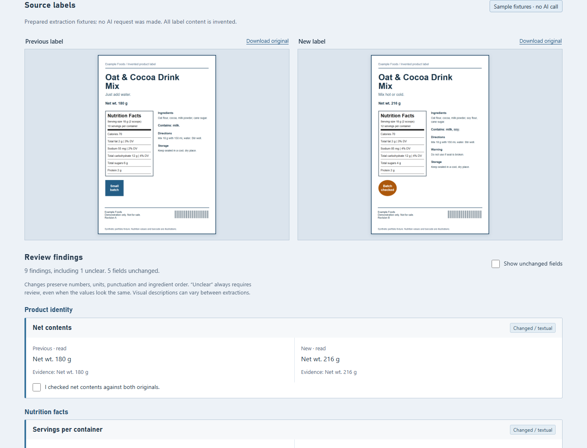
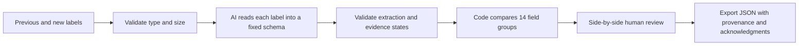

# Label Review

[](https://github.com/PatrickSchaller/label-comparison-demo/actions/workflows/verify.yml)

An AI-assisted product-label comparison demo: give it the previous label and the new label, inspect the extracted evidence, and review the differences beside the originals.

It demonstrates the core workflow behind an internal business problem I have worked on. This is an independent implementation using invented labels, new code and a new prompt. It includes no employer source code, customer labels, internal services or credentials.



## Try it without an API key

Requires the [.NET 10 SDK](https://dotnet.microsoft.com/download/dotnet/10.0). There are no application NuGet dependencies and no frontend build step.

```sh
dotnet restore LabelReview.sln
dotnet run --project src/LabelReview
```

Open **http://127.0.0.1:5098** and select **Run sample comparison**. The sample compares prepared, hand-authored extraction fixtures. It does not call an AI model or pretend to be a recorded model run.

The invented label revision changes net contents, serving count, nutrition values, ingredient wording, marketing copy, a warning, a badge and revision text. A deliberately blurred allergen line becomes an explicit caution. Expected result: **9 findings, including 1 unclear; 5 unchanged fields**.

Check findings against the two source images, show unchanged fields, and export a JSON review. Export works while review is pending. Checking every finding acknowledges inspection; it never changes an unclear reading into a verified fact or approves a label. Choices reset on a new comparison or page reload.

## Use live AI extraction

Supply your own OpenAI API key and the ID of a model that supports image/PDF inputs, the Responses API and strict structured outputs. Both settings are required; the demo does not silently choose a model. API usage is charged to your account.

PowerShell:

```powershell
$env:OPENAI_API_KEY = 'your-own-api-key'
$env:OPENAI_MODEL = 'your-compatible-model-id'
dotnet run --project src/LabelReview
```

macOS/Linux:

```sh
export OPENAI_API_KEY='your-own-api-key'
export OPENAI_MODEL='your-compatible-model-id'
dotnet run --project src/LabelReview
```

Set credentials in your local shell; do not commit them. Restart after changing configuration. Credentials stay on the server. Upload one previous and one new PNG, JPEG or PDF (maximum **6 MiB each**), confirm that you may share them, and select **Extract & compare with AI**. A PDF is sent as a PDF, including its pages; a browser-native PDF preview may be unavailable, so each original also has a download link.

Each comparison makes **two sequential extraction requests**, one per document. There are no automatic retries. If either fails, no partial comparison is displayed. The local server allows one live comparison at a time with a three-minute overall deadline. Retry manually if appropriate; a request that failed or timed out may still incur provider charges.

The provider uses [image inputs](https://developers.openai.com/api/docs/guides/images-vision), [PDF file inputs](https://developers.openai.com/api/docs/guides/file-inputs), and [strict structured outputs](https://developers.openai.com/api/docs/guides/structured-outputs). Requests set `store: false`; that setting is not a guarantee of zero retention. Check the provider's current data policies before uploading sensitive material.

**Live paid-model output has not been validated in this repository's checks.** Tests simulate the provider protocol. Use the sample PNGs for your first live run and inspect every extracted field before drawing conclusions about accuracy.

## How it works



The schema covers product identity, facts-panel content, ingredients, allergens, claims, directions, warnings, storage, manufacturer/disclaimers, visual marks and other text. Each field has a value, evidence and a reading state: `read`, `absent` or `unclear`. Missing keys, duplicate keys, unknown fields, invalid evidence states, malformed responses, refusals and incomplete responses fail closed.

Comparison is deliberately conservative: collapse whitespace and ignore case, but preserve punctuation, amounts, units and ingredient order. Any uncertain reading is a `review` item, even if the two extracted values match. Findings distinguish textual changes, visual-description changes and cautions. Facts rows are retained together as one field group, so a change shows the full panel text for review.

Why a deterministic comparison after AI extraction? It makes the decision rule inspectable and testable. A second model judging whether a change “matters” could hide small but important numerical or allergen changes. The tradeoff is extra findings from harmless wording differences, especially in visual descriptions.

Read the [code walkthrough](docs/code-walkthrough.md), [validation record](docs/validation.md), or inspect the [synthetic extraction fixtures](src/LabelReview/wwwroot/samples/extractions.json).

## Verify it

```sh
dotnet test LabelReview.sln -c Release
dotnet publish src/LabelReview -c Release -o artifacts/app
```

For browser tests, also install Node.js 22 or later:

```sh
npm ci --ignore-scripts
npx playwright install chromium
npm test
```

The browser suite disables live AI. GitHub Actions builds, tests and publishes the app on Windows/Linux, and runs Chromium checks on Linux. To recreate the invented PNG fixtures after changing their source, run `npm run samples`.

## Scope and limits

- Local demonstration only. The server binds to loopback and rejects non-local connections and unexpected Host headers. No accounts, shared hosting, database or durable job queue are included.
- A custom request header and no CORS policy block ordinary cross-site form submissions. Uploaded label bytes stay in request memory; the app does not save labels or review history. Exported reports contain label content, so keep them appropriately.
- Size, extension and magic-byte checks are basic validation, not a full image/PDF parser or malware scanner. AI-provider parsing can still reject damaged, encrypted or complex documents.
- AI can miss text, misread small print, obey malicious document instructions despite the prompt, or misclassify absence. Strict JSON does not prove extraction accuracy. No OCR geometry, crop overlays, barcode decoding or regulatory rules are implemented.
- Visual marks are compared as descriptions, not by pixel or geometric registration. Position-only changes may be missed; wording variation can produce a false difference. Use clear, upright labels and inspect the originals.
- Browser review acknowledgments are unsaved, unsigned statements, not an audit trail. This is neither a print-release system nor a safety/compliance decision maker.

Implementation was created with AI assistance and is intended to be explained, reviewed and extended as a portfolio example. No measured time savings, production accuracy, regulatory validation or client results are claimed.

MIT licensed. All sample product content and artwork in this repository are invented demonstration fixtures.
